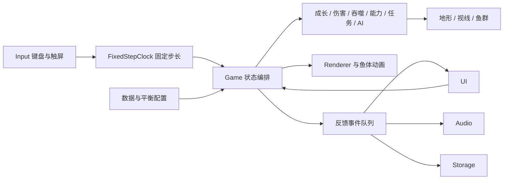

# 开发交接

## 目录与职责

```text
src/
  core/       Game 状态与编排、固定步长时钟、坐标数学、共享数据结构
  data/       鱼种 / 成长阶段 / 海域 / 技能 / 进化配置，以及集中平衡参数
  systems/    游动、吞噬、成长、生命、能力、鱼群生态、精英战斗与任务
  world/      带种子的海域生成、实体碰撞、视线与奖励安全位置
  render/     Canvas 鱼体、场景、摄像机、环境与攻击预警
  platform/   键盘 / 触屏、Web Audio、本地存储与校验
  ui/         菜单、HUD、弹窗、图鉴、设置与交互意图
  main.ts     输入采样 → 固定逻辑帧 → 绘制 → 反馈事件的主循环
public/       随包部署的 WebP 插画与 SVG 标识
art-source/   四张原始 PNG 插画，供后续重制或重新压缩
tests/        规则测试、正常输入主线驾驶员、无尽逻辑耐久
scripts/      生产离线资源清单生成
docs/         交接、素材说明、测试记录与浏览器截图
```



`Game` 不导入 DOM、音频或浏览器存储。逻辑通过事件队列发出声音、提示、保存与结算意图。测试可直接运行这个引擎，界面不能绕过逻辑校验分发奖励。

## 坐标、时间与主循环

世界是 13000 × 2200 的侧视二维平面。x 向右，y 向下，逻辑距离使用世界像素；速度为世界像素 / 秒，计时统一为秒。显示的 cm / m 是可读的游戏内量尺。

`FixedStepClock` 以 1/60 秒推进逻辑，保留不足一步的时间余量，支持 60/120/144Hz 渲染。每个渲染帧最多补算 80ms。暂停、失焦和恢复时清空旧余量，避免后台补算。E / F 的单次边沿只给一批逻辑步的第一步。

所有逻辑更新都经 `Game.update`，只有 `playing` 状态执行。暂停、图鉴、设置、进化和事件统一冻结鱼群、攻击、技能、机关、临时增益和任务时钟。

## 吞噬与生命

- `relation` 决定食物、接近体型、危险、毒性和特殊目标，渲染提示直接调用它。
- 普通可捕食条件为 `player.size >= target.size * 1.2`；`size` 表示半身长。
- 主角的 `mouth` 与关节鱼体绘制共用 `fish-rig.ts` 的 `fishSpine(rig,1)` 嘴尖；前方取 headAngle，不用身体中心或行进方向代替鱼头。特殊掠食者保留攻击角度的 0.79 倍 size，轻量普通鱼采用 `poseNose`。`mouthContact` 检查前后帧嘴尖的连续扫掠和前向关系，支持弯身、斜游、冲刺追鱼；普通鱼轻量侧身最窄时的防误吞规则不限制主角弯身咬合。
- 吞噬还检查地形视线。奖励前先置 `alive=false`，所有循环跳过死亡实体，确保同一目标一次结算。
- `receiveDamage` 先扣护盾，再扣生命，开启 1.45 秒接触保护。保护期间其他接触也不重复伤害；被护盾吸收的攻击同样有受击窗口。
- 普通食物少量恢复，金辉灯鱼额外恢复，庇护所在附近没有追击时持续恢复。练习模式明确不损失生命。

## 鱼群与掠食者

邻近普通鱼使用 180 像素网格查询同伴，组合对齐、向心和分离；逃散时远离玩家与大型捕食者。远处对象不执行昂贵的追击和视线检测。

礁巡鲨 / 海鳗只在有限距离、朝向与无遮挡条件下锁定玩家。超过脱离距离、巡逻半径、追击计时或进入墨云后返回巡游。海草拟态进一步降低侦测范围。

开局允许已有鱼群；之后普通补鱼和无尽潮汐事件统一通过 `spawning.ts` 从画面左、右之外生成。Renderer 每帧提交当前画面与预期缩放范围的并集，逻辑再额外留出整条鱼与尾鳍的宽度。边界或岩体没有位置时换另一侧，两侧都不合适就跳过本次，不能把生成点夹回屏内。

新增鱼带有 `arrivalTarget`，初速度朝内，抵达后恢复巡游；即便生成点超出常规 1800 像素 AI 距离，也继续推进其入场游动。猎食者的巡游终点避开出生庇护所。`spawnHistory` 只保留最近 28 条生成记录供浏览器取证，不进入存档。

精英状态顺序为巡游 → 蓄力 → 冲撞 / 尾扫 / 水流 → 弱点 → 巡游。蓄力锁定方向，冲撞过程中不持续转向追踪。弱点每轮仅允许一次咬击；电流对精英的干扰只有 0.8 秒。

## 地图与任务可达性

三海域骨架固定，种子决定边缘岩体、鱼群、支路事件、信标布置、任务组合与精英位置。中心 `y=1100` 保留足够净宽，最大玩家也可通过；狭窄支路不承担唯一主线。

`findOpen` 排除实体内部奖励位置。出生点附近有小鱼群，主动捕食者不得放到出生安全空间。必需信标是独立对象，不会被生态吃掉。

`missionPlan` 组合三信标探索，或两信标加本地捕食数量；第三座信标仍有额外成长奖励。界面说明、方向导航和挑战启用共用任务条件。食物补充按“附近可捕食数量”计算，避免不可食用大鱼占满名额导致任务无食物可做。

地形碰撞为扩张椭圆的近似实体检测。环境插画仅是无交互远景，实际可碰撞岩体有更明确的前景轮廓；不能根据远景插画推断碰撞。

## 成长、构筑与摄像机

成长阶段阈值见 `STAGES`，初始 size=20（HUD 显示体长 40 cm），最初只能吞噬更小的银线沙丁鱼。阶段间连续插值目标体型，实际体型以指数平滑追随目标，吞噬资格与绘制始终使用同一实际体型；最终阶段采用对数增长并封顶 148。练习选阶段和读取存档直接恢复对应体型。

主角始终使用同一条橙金色鱼的基础轮廓，身高、尾柄和背鳍随实际体型连续成熟，不在成长阶段边界突然由蝶鱼切换成金枪鱼。阶段依旧提供能力选择和成长反馈。

`movement.ts` 控制实际速度、位置与行进角度；主角通过 `fish-rig.ts` 的 headAngle / bodyAngle / tailAngle 形成关节链，响应速率依次为 18 / 9 / 6。常态上下游鱼头俯仰上限约 32°，躯干与尾部随后跟随，停止后沿同样的链条回到水平。

左右转向通过约 0.4 秒的小弧线改变实际速度，并在弧线中段适度减速。鱼体沿两段连续三次中线弯成轻微 C 形，由 `render/player-fish.ts` 铺开轮廓、鳍、条纹和鳞片，不再压缩整条主角鱼来表现换向。再次反向时互换当前弧线的起终点并反转进度，保持姿态连续；松手后停止实际推进，剩余身体动作柔和舒展。

普通鱼仍由 `swimming.ts` 使用约 22° 俯仰和轻量侧身动画，以控制鱼群开销；特殊精英按攻击角度绘制，保证冲撞预警和弱点一致。鱼嘴与鱼体中线共用纯函数，不把关节状态写在渲染循环里。

`BALANCE.foodGrowthScale` 控制食物成长收益；鱼种 food 控制风险价值。优先调整这两项与阶段阈值，再观察正常输入主线日志。不要只调移速来凑用时。

摄像机平滑跟随并按朝向前瞻。观察宽度以视口宽度和体型计算，手机不会因屏幕矮而把全部鱼缩得过小；各设备横向威胁预警距离接近。镜头缩放与背景过渡均平滑插值。

每种进化只出现一次，效果以 `has(id)` 查询。连吞奖励最高四层，技能冷却非负，体力封顶 100，紧急护盾每海域一次，重复护盾取较大值而非无限叠加。

## 扩展内容

### 新增鱼种

1. 在 `catalog.ts` 的 `SPECIES` 添加唯一 id、中文说明、shape、色彩、体型、速度、收益、行为和海域。
2. 能复用已有体型时选择 shape；独立轮廓则在 `render/fish.ts` 添加形状绘制分支，同时扩展 `Shape`。
3. 新行为进入 `ecology.ts`；特殊掠食者进入 `combat.ts`，不把战斗计时写进渲染器。
4. 图鉴自动读取配置；检查生成、嘴部判定与大鱼警示。

### 新增能力或进化

能力先增加 `ABILITIES` 数据，再在 `abilities.ts` 实现有限范围 / 持续时间 / 冷却。通过事件提供音效与教程。UI 的秘藏与练习选择自动读取能力表。

进化先增加 `EVOLUTIONS`，在对应系统通过 has 查询生效，明确上限和触发条件。复杂强化应进入自己的系统函数，不在 UI 中修改成长或敌人状态。

### 新增任务或事件

主线条件放在 `missions.ts`，同时更新描述、目标位置与完成条件。需要新的累计量时扩展 `RegionProgress` 和存档校验；需要新增存档版本时编写显式迁移，未知版本仍安全拒绝。

事件先定义奖励类型，再由 `resolveEvent` 原子结算。奖励前核对 `site.used`，设置后才发成长、技能和保存事件。漂游贝商的馈赠使用本局分数交换，不使用真实货币。

## 输入与触屏边界

摇杆与冲刺分别记录 pointerId，技能和交互为单次边沿。第二根手指不覆盖摇杆指针。取消捕获、pointercancel、失焦与暂停都会释放状态。

桌面 HUD 与手机各有一个技能入口，绑定时必须遍历全部节点；使用 querySelector 只绑定第一个会导致隐藏的桌面节点吃掉触屏绑定。此问题已在浏览器发现并修复。

摇杆大小与透明度写入 CSS 变量。触屏样式在粗指针设备或小视口启用，横屏适配 safe-area；不依赖 UA 字符串。

## 存储与恢复

`Storage` 使用 `deep-blue-feast:v1:`，分别保存旅程、设置和本地纪录。`validateSave` 检查所有必需字段、数字范围、id 与版本；损坏数据返回无可继续的存档，不抛至主界面。

旅程保存精确的已使用站点 id，不能只凭信标数量恢复，否则非顺序收集会恢复错目标。待选进化次数也要保存，防止刚成长就刷新丢失强化。

恢复到当前海域固定庇护所，重新生成生态，保留已完成目标 / 进化 / 技能 / 图鉴 / 统计。敌人的部分受击次数不保留，已驱离状态保留。正在进行的攻击、保护帧、临时护盾、墨云和旧输入不恢复。

## 构建与诊断

`npm run format` 统一格式；`npm test` 检查纯逻辑；`npm run test:journey -- <seed>` 运行正常输入驾驶员；`npm run test:endurance` 做 30 分钟逻辑耐久。

运行中隐藏的 `#game-diagnostics` output 提供只读 DOM 快照，包含位置、目标、附近生物、进度、相机与统计，供浏览器测试读取。它不提供写入、加成长、瞬移或调用胜利的接口。不要用修改内部状态替代实际通关。

生产构建后 `offline.mjs` 根据实际哈希资源写离线缓存。安装通过版本查询参数穿过旧缓存，再以标准资源路径入库。保留当前与上一版本，避免旧页面请求已删除的哈希；页面导航联网优先、离线退回已缓存页面。静态资源忽略预览服务器的 `Vary: Origin`，防止模块脚本与预缓存请求的 Origin 不同而离线匹配失败。只清理本项目前缀的旧缓存。

`platform/offline.ts` 负责注册与更新，隐藏的 `#offline-diagnostics` 输出安装状态和本项目缓存文件数。该流程与游戏循环解耦，浏览器拒绝缓存时不妨碍联网游玩。

## 已知边界

画面为二维 Canvas 与插画视差，地形和长鱼采用近似碰撞体。音景为程序合成而非真人录制。没有在线多人、云端同步或外部排行榜。目标一局时长受熟练程度与探索选择影响，不作强制倒计时限制。

真机多指触控、Safari 音频策略、移动 GPU 帧率与长时间散热，需要在真实设备验证；本次浏览器视口测试与逻辑耐久不替代上述测试。
